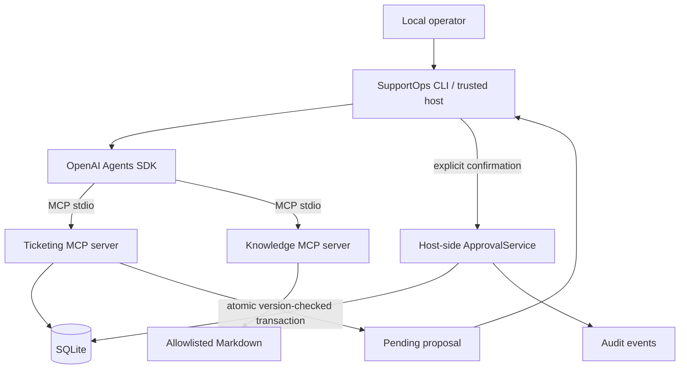

# SupportOps MCP — AI IT Helpdesk Copilot

SupportOps is a portfolio-ready local MVP showing how an AI helpdesk copilot can discover and call tools from two independent Model Context Protocol (MCP) servers. It uses only coherent fictional data and never connects to a real ticketing, Microsoft 365, identity, or network system.

## Business problem

N1/N2 technicians often move between ticket history and procedural knowledge. This project gives an OpenAI agent a standard MCP interface to both while reserving ticket writes for a trusted human-controlled application layer.

## Architecture



MCP tools are model-controlled operations with typed input schemas. Resources are application-controlled, read-only context addressed by URI. Prompts are user-controlled reusable templates; this MVP intentionally exposes no prompt because the agent instructions belong to the trusted host.

## Components and tools

`supportops-ticketing` exposes `list_tickets`, `get_ticket`, `search_tickets`, and `prepare_ticket_update`. The last tool can persist only a session-bound `PENDING` proposal; there is no MCP approval tool.

`supportops-knowledge` exposes `search_knowledge`, `get_procedure`, and the read-only resource template `supportops://knowledge/{procedure_id}`. Procedure identifiers map through a fixed allowlist; callers cannot supply filesystem paths.

The host uses OpenAI Agents SDK `MCPServerStdio` to connect the agent to both subprocesses. The key is read only from `OPENAI_API_KEY`, and the model from `OPENAI_MODEL` (default `gpt-6-astra`).

## Stack and repository

Python 3.11+, MCP Python SDK v2, OpenAI Agents SDK, Pydantic, SQLite, Typer, pytest, Ruff, and uv. Application code lives under `src/supportops`; fictional procedures under `knowledge`; tests under `tests`; design notes under `docs`.

## Install

Windows PowerShell:

```powershell
py -3.11 -m pip install uv
uv sync
Copy-Item .env.example .env
uv run supportops init --reset
uv run supportops demo
```

Linux:

```bash
python3 -m pip install --user uv
uv sync
cp .env.example .env
uv run supportops init --reset
uv run supportops demo
```

Without uv, create a Python 3.11+ virtual environment and run `pip install -e ".[dev]"`; uv is preferred because `uv.lock` pins the full environment.

## Usage

No OpenAI key is needed for the real-protocol demo and local controls:

```bash
uv run supportops init
uv run supportops demo
uv run supportops tickets
uv run supportops proposals
uv run supportops audit
```

The demo launches both servers as separate subprocesses, discovers their tools, calls them over stdio, reads an MCP resource, and creates a pending proposal. Results are produced by the servers, not hard-coded client output.

For the agent, set `OPENAI_API_KEY` in the environment (or `.env`), optionally set `OPENAI_MODEL` to a model available to your project, then run:

```bash
uv run supportops chat
```

Example requests: `Analyze ticket INC-1042.`, `Find the Outlook sending procedure.`, or `Analyze INC-1042 using the knowledge base.`

## Human approval

After a proposal is created, inspect it and make a terminal decision:

```bash
uv run supportops proposals PENDING
uv run supportops approve PROP-XXXXXXXXXXXX
# or
uv run supportops reject PROP-XXXXXXXXXXXX
```

The CLI displays every proposed field and requires an explicit confirmation. The controller verifies status, session, expiry, and ticket version inside a SQLite `BEGIN IMMEDIATE` transaction. A proposal is single-use. Rejections do not modify tickets; stale, expired, cross-session, repeated, and non-trusted decisions are refused and audited.

## Tests and quality

```bash
uv run pytest
uv run ruff check .
```

Tests cover services, input/path defenses, true in-memory MCP protocol calls, a separate-process stdio path, MCP resource reading, approval state changes, atomicity controls, and deterministic agent policy/configuration without paid calls. A live OpenAI run is optional because it needs account credentials and model access.

## Security

- Local stdio only; no listening network endpoint.
- Parameterized SQL and strict Pydantic boundary validation.
- Fixed procedure allowlist and resolved-path containment.
- Agent sees proposal creation but no commit/approval capability.
- Host-derived session/user identity, proposal expiry, optimistic ticket versioning, atomic single-use state transitions, and audit logs.
- Ticket and knowledge output is explicitly treated as untrusted prompt-injection-capable data.
- No credentials in source, seed data, or logs.

This is a local educational control model, not enterprise authentication or production authorization. The child processes still run with the local user's OS permissions; production deployment would require sandboxing, identity, policy enforcement, TLS, token audience validation, rate limits, and monitoring.

## Demo scenarios

See [docs/demo-scenarios.md](docs/demo-scenarios.md) for five repeatable scenarios, double-approval behavior, and a fictitious prompt-injection test. See [docs/architecture.md](docs/architecture.md), [docs/mcp-tools.md](docs/mcp-tools.md), and [docs/security.md](docs/security.md) for implementation detail.

## Limitations and roadmap

The deterministic demo, MCP servers, SQLite workflow, approvals, audit, and tests work without OpenAI. Natural-language agent reasoning requires `OPENAI_API_KEY` and access to the configured model. Search is intentionally lexical; identity is local environment configuration; there is no remote deployment.

Possible future work includes authenticated Streamable HTTP with TLS and origin/token validation, a React dashboard, Neon PostgreSQL, Qdrant-backed knowledge retrieval, authorized Jira/GLPI adapters, n8n workflows, observability, rate limiting, sandboxing, and production deployment. None is part of this MVP.

## Disclaimer

All users, tickets, systems, and procedures in this repository are fictional. This MVP is not represented as deployed at or validated by a customer organization.

# SupportOps-MCP
