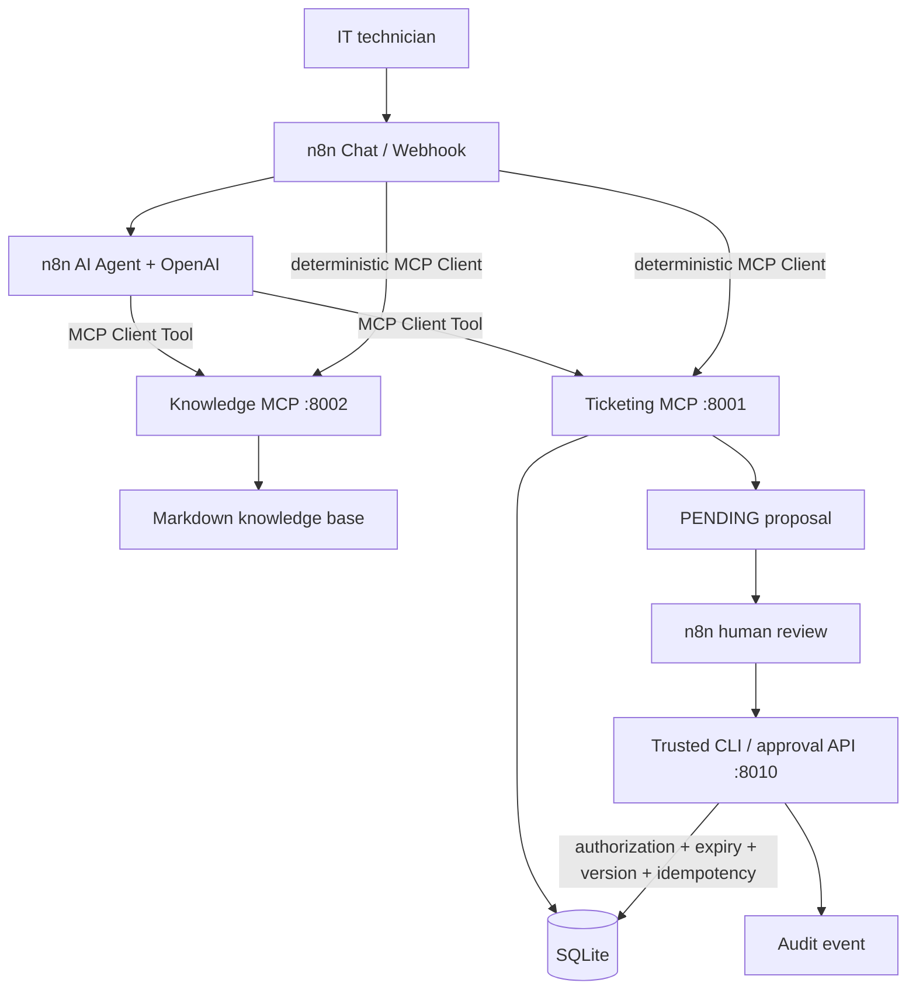

# SupportOps MCP — n8n AI Helpdesk Automation Platform

SupportOps is a portfolio-grade local demonstration of hybrid AI automation. n8n orchestrates an OpenAI agent and deterministic workflows; two real Python MCP servers provide fictional tickets and allowlisted IT procedures; Python retains transactional authority for proposals, human decisions, and audit.

All data is fictional. The project connects to no real ticketing, Microsoft 365, identity, Windows, or network environment and is not represented as deployed for customers.

## Architecture



n8n owns intake, workflow routing, agent orchestration, human-review coordination, and error classification. OpenAI understands and synthesizes. Python owns validation, persistence, authorization, version control, transactions, and audit. The model never receives an approval tool.

## MCP servers

`supportops-ticketing` exposes:

- `list_tickets`
- `get_ticket`
- `search_tickets`
- `prepare_ticket_update`

`supportops-knowledge` exposes:

- `search_knowledge`
- `get_procedure`
- read-only resource `supportops://knowledge/{procedure_id}`

Both support stdio and MCP Streamable HTTP. Stdio remains the default for the CLI. HTTP defaults to loopback endpoints:

```text
http://127.0.0.1:8001/mcp  Ticketing
http://127.0.0.1:8002/mcp  Knowledge
http://127.0.0.1:8010      Approval API
```

## n8n workflows

Seven importable exports are under `n8n/workflows`:

| Workflow | Purpose |
|---|---|
| 01 Main AI Helpdesk Chat | Chat Trigger, AI Agent, OpenAI model, both MCP Client Tools, session memory |
| 02 Ticket Analysis | Deterministic validated `get_ticket` call |
| 03 Knowledge Retrieval | Deterministic lexical knowledge search and no-result handling |
| 04 Incident Diagnosis | Both MCP servers plus a validated structured diagnosis schema |
| 05 Approval Request | Reads exact proposal data and pauses for human review |
| 06 Ticket Decision | Authenticated webhook calling the trusted approval API |
| 07 Error Monitoring | Redacted error classification and execution correlation |

They target **n8n 2.45.7**. JSON syntax, node roles, graph references, credential absence, and tool separation are tested. Import and execution on a live n8n instance are **NON VÉRIFIÉ** in this environment because an ephemeral n8n installation timed out. See [n8n/README.md](n8n/README.md).

## Human approval and reliability

Proposal preparation records the exact change, session, host identity, ticket version, expiry, correlation ID, and optional idempotency key. Retrying the same key/payload returns the original proposal; changed payloads are rejected.

The trusted controller performs a SQLite `BEGIN IMMEDIATE` transaction, verifies PENDING state, session, expiry, authorization, and ticket version, then writes the note, increments the ticket version, updates the proposal, and records an audit event atomically. A matching decision retry key returns the original audit ID without applying twice. Ordinary double decisions remain conflicts.

Remote decisions are disabled by default. The local CLI is the recommended MVP approval path:

```bash
uv run supportops proposals PENDING
uv run supportops approve PROP-XXXXXXXXXXXX
uv run supportops reject PROP-XXXXXXXXXXXX
```

## Installation — Windows PowerShell

```powershell
cd C:\path\to\SupportOps-MCP
py -3.11 -m pip install uv
uv sync
Copy-Item .env.example .env
uv run supportops init --reset
uv run supportops demo
uv run pytest
uv run ruff check .
```

## Installation — Linux

```bash
cd /path/to/SupportOps-MCP
python3 -m pip install --user uv
uv sync
cp .env.example .env
uv run supportops init --reset
uv run supportops demo
uv run pytest
uv run ruff check .
```

Without uv, create a Python 3.11+ virtual environment and install with `pip install -e .`. Development dependencies use uv's `dev` dependency group.

## Local MCP HTTP

PowerShell terminals:

```powershell
$env:SUPPORTOPS_MCP_TRANSPORT = "streamable-http"
$env:SUPPORTOPS_TICKETING_HOST = "127.0.0.1"
uv run supportops-ticketing
```

```powershell
$env:SUPPORTOPS_MCP_TRANSPORT = "streamable-http"
$env:SUPPORTOPS_KNOWLEDGE_HOST = "127.0.0.1"
uv run supportops-knowledge
```

HTTP uses the MCP SDK's Host/Origin checks, DNS-rebinding protection, bounded request bodies/sessions, and an optional `SUPPORTOPS_MCP_BEARER_TOKEN`. Never expose an unauthenticated server publicly.

## Docker Compose

```powershell
Copy-Item .env.example .env
docker compose up --build -d
docker compose ps
```

The three services publish ports to host loopback only. The SQLite volume is centralized in `supportops-data`. If an existing n8n container joins the same network, use service-name endpoints from the exports. If n8n runs in a separate container while Python runs on the host, use `host.docker.internal`, not `127.0.0.1`.

## n8n setup

1. Start the two MCP HTTP servers and optionally the approval API.
2. Import all files from `n8n/workflows`.
3. Replace endpoints for your host/network layout.
4. Create an OpenAI credential; select a tool-capable model actually available to it.
5. If MCP bearer auth is enabled, select Bearer Auth on all MCP nodes.
6. Configure HTTP Header Auth for the approval API and decision webhook.
7. Keep remote decisions disabled and use the CLI unless isolated-demo authorization is deliberately configured.
8. Test workflow 02 and 03 before enabling the AI Agent.
9. Test `INC-1042`, then a PENDING proposal, rejection, approval, retry, expiry, and stale version.
10. Inspect `uv run supportops audit` and n8n execution logs.

The model values in exports are n8n node defaults, not availability guarantees. No API key is stored in source or workflow JSON.

## OpenAI Python CLI agent

The original Python agent remains available as an optional compatibility path:

```powershell
$env:OPENAI_API_KEY = "set-in-your-shell-or-secret-store"
$env:OPENAI_MODEL = "a-tool-capable-model-available-to-your-project"
uv run supportops chat
```

No model is hard-coded when `OPENAI_MODEL` is empty. A live OpenAI request was not tested because no API key was present.

## Verified results

```text
uv run pytest                                  28 passed
uv run ruff check .                            All checks passed
uv run python n8n/tests/validate_workflows.py  7 valid JSON graphs
docker compose config --quiet                  passed
docker compose build                           passed
Docker health                                  3/3 healthy
```

Docker-host MCP clients discovered both tool sets, retrieved `INC-1042`, found the Outlook procedure, and observed remote decisions disabled. Stdio regression tests also pass.

## Security boundaries

- Parameterized SQL and strict typed boundary validation.
- Allowlisted procedure IDs plus resolved-path containment.
- Prompt-injection-aware agent instructions and source-only citations.
- No SQL, shell, arbitrary-file, approval, or rejection tool exposed to the model.
- Optional MCP bearer authentication and approval API authentication.
- Transactional single-use decisions, version checks, expiry, audit IDs, and retry keys.
- No credentials in workflow exports, source, seed data, or logs.

Remaining MVP limitations include local environment identity for MCP proposal ownership, shared-token demo authorization, unsandboxed local subprocesses, SQLite single-host constraints, unverified n8n runtime import, and no live OpenAI evaluation.

## Documentation

- [V2 audit](docs/v2-audit.md)
- [Architecture](docs/architecture.md)
- [n8n integration](docs/n8n-integration.md)
- [MCP HTTP](docs/mcp-http.md)
- [Approval security](docs/approval-security.md)
- [Deployment](docs/deployment.md)
- [Testing](docs/testing.md)
- [Demo scenarios](docs/demo-scenarios.md)
- [French portfolio presentation](docs/presentation-fr.md)
- [Roadmap](docs/roadmap.md)
