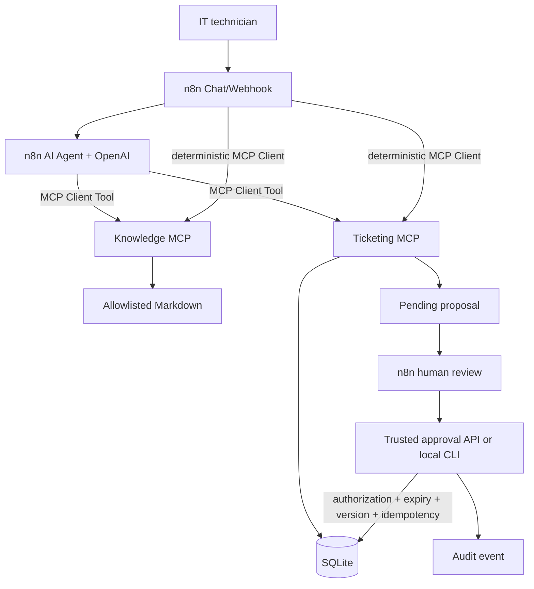

# Hybrid architecture

n8n owns orchestration, chat, deterministic sub-workflows, human-review coordination, and error routing. OpenAI interprets requests and produces bounded synthesis. Python remains authoritative for validation, allowlisted file access, proposal state, authorization checks, concurrency, transactions, and audit.

The AI Agent receives only six MCP tools: ticket list/get/search, knowledge search/get, and proposal preparation. Approval is an HTTP/CLI control-plane action and is never an agent tool.

SQLite is appropriate for one local host with centralized writers. A multi-host deployment requires a server database such as PostgreSQL and transaction semantics reviewed for that database.
