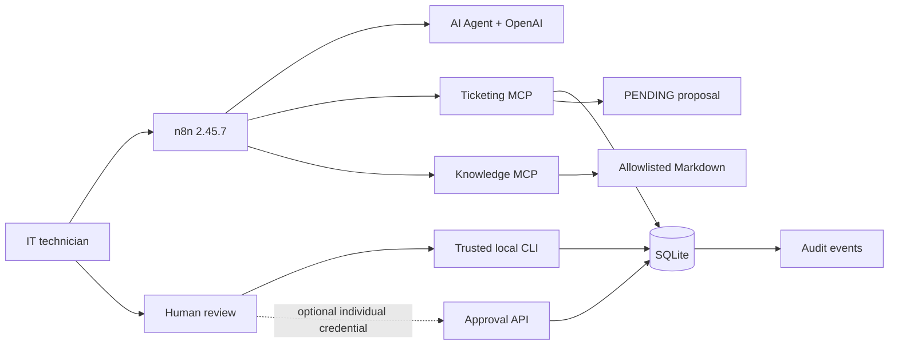
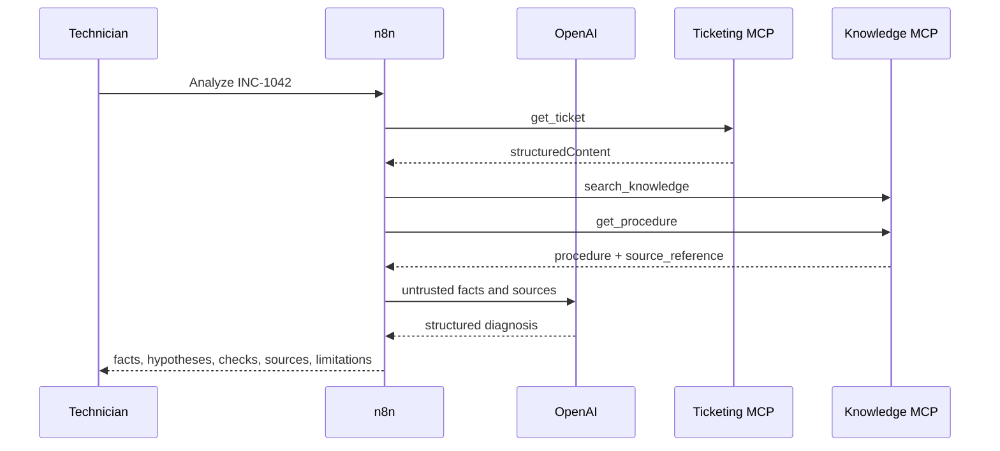
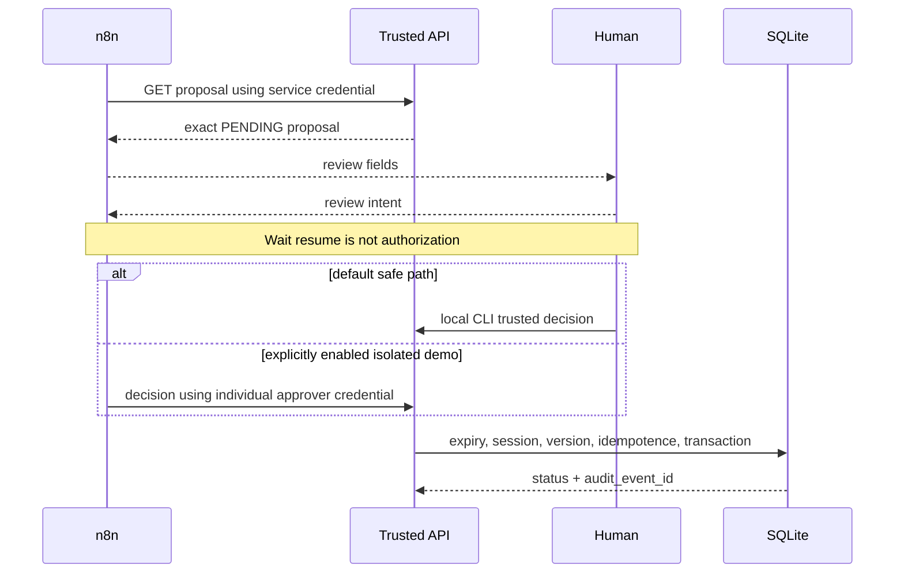
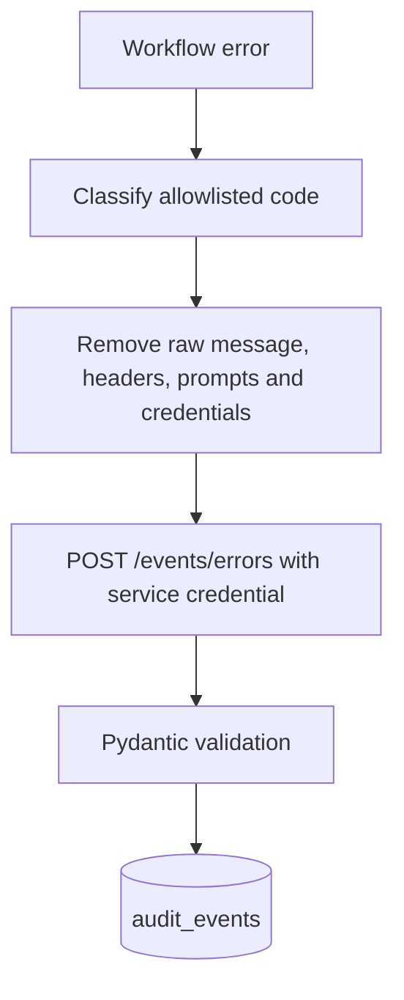

# V2.1 architecture

## General architecture

## Incident-analysis sequence

## Human-decision sequence

## Error and audit flow

Correlation IDs connect n8n executions to proposals and audits. Proposal and decision idempotency keys prevent repeated effects.
