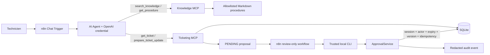

# SupportOps MCP V2.2 — architecture

## Responsabilités

- **n8n** reçoit le chat, orchestre l'agent, appelle les outils MCP, présente une revue humaine et classe les erreurs.
- **OpenAI** interprète et synthétise des données fournies ; il n'a aucun outil d'approbation.
- **Ticketing MCP** expose les lectures et la préparation d'une proposition, jamais l'application directe.
- **Knowledge MCP** expose une recherche et une lecture de procédures allowlistées.
- **Python** valide les entrées, persiste SQLite, contrôle les versions, applique les transactions et écrit l'audit.
- **CLI locale** est le contrôleur de confiance MVP tant qu'une identité distante forte n'est pas validée.

Les données d'outils sont non fiables : les instructions présentes dans un ticket ou une procédure ne changent jamais la politique de l'agent.

## Corrélation

Les workflows propagent `correlation_id` et utilisent `n8n-<execution id>` par défaut. Les propositions conservent le ticket, la session, la version, l'expiration, la clé d'idempotence et l'identifiant de corrélation. Les erreurs persistées sont limitées à un code et des identifiants contrôlés.

## Réseau

Dans le même réseau Docker : `supportops-ticketing:8001`, `supportops-knowledge:8002`, `supportops-approval:8010`. Depuis n8n sur Windows : `127.0.0.1`; depuis un conteneur n8n vers des serveurs sur l'hôte : `host.docker.internal`. Les ports Compose sont liés à loopback.
